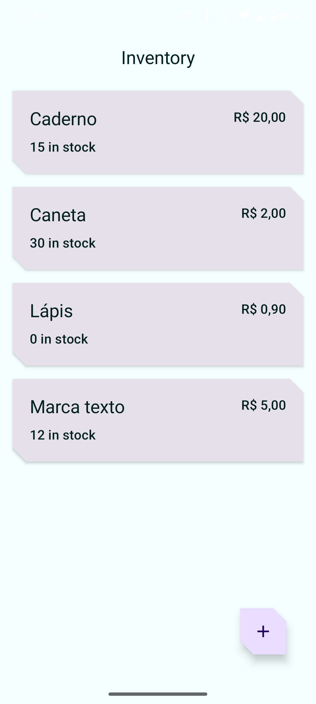
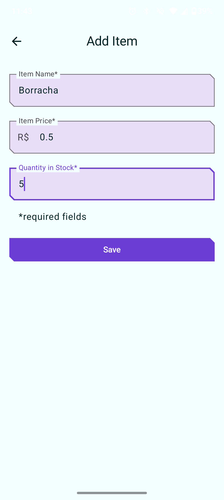
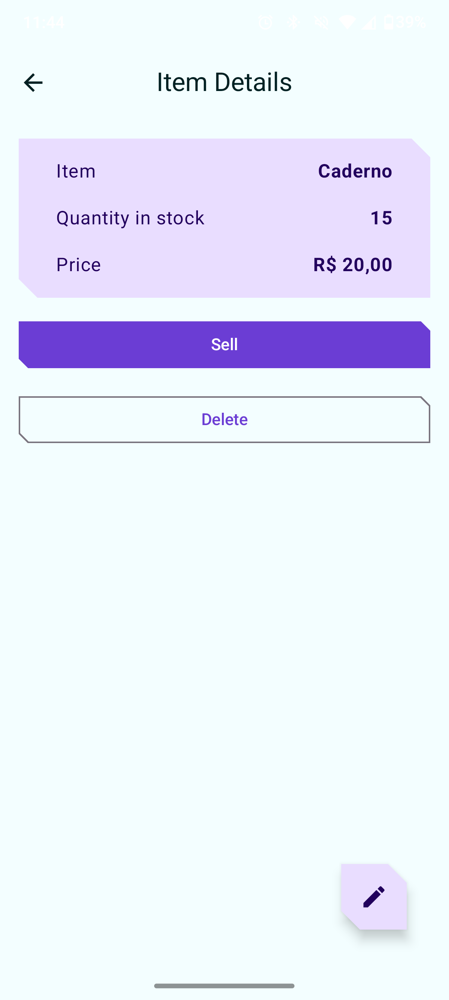
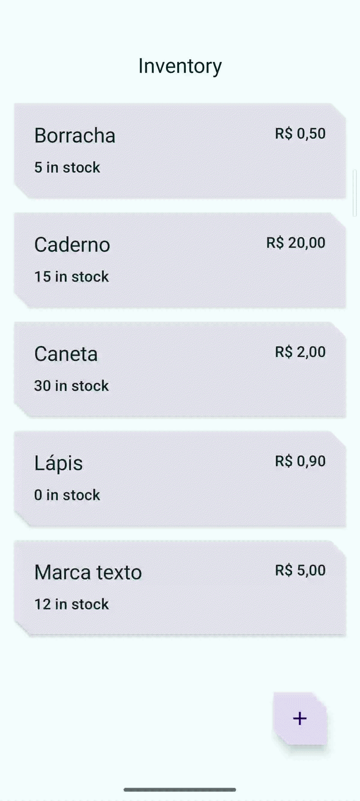

# Persistência de Dados no Android com Room Database (Inventory App)

Este repositório contém a implementação da aplicação **Inventory**, desenvolvida ao longo de dois codelabs do Google sobre persistência de dados no Android:

1.  [Persistir dados com o Room](https://developer.android.com/codelabs/basic-android-kotlin-compose-persisting-data-room?hl=pt-br#0)
2.  [Ler e atualizar dados com o Room](https://developer.android.com/codelabs/basic-android-kotlin-compose-update-data-room?hl=pt-br#0)

O projeto demonstra a construção de um fluxo completo de **CRUD** (Criar, Ler, Atualizar e Eliminar) utilizando a biblioteca **Room** integrada com **Jetpack Compose**, **StateFlow** e a arquitetura recomendada pela Google (DAO + Repository Pattern).

## Tecnologias e Ferramentas Utilizadas

- **Linguagem:** Kotlin
- **UI Framework:** Jetpack Compose (Material Design 3)
- **Persistência Local:** Room Database (SQLite)
- **Concorrência e Asincronismo:** Kotlin Coroutines & Flow / StateFlow
- **Arquitetura:** MVVM (Model-View-ViewModel) + Repository Pattern + Dependency Injection Manual (`AppContainer`)
- **Testes:** Room In-Memory Database Tests (`ItemDaoTest`)

## Conceitos e Aprendizados Práticos

Os aprendizados do projeto dividem-se nos dois codelabs:

### 1. Persistência de Dados com Room (Parte 1)
- **Mapeamento de Entidades:** Criação da classe `Item` anotada com `@Entity(tableName = "items")` e chave primária autogerada.
- **Criação do DAO (Data Access Object):** Interface `ItemDao` com métodos anotados para inserção (`@Insert`).
- **Configuração da Base de Dados:** Criação da classe abstrata `InventoryDatabase` herdando de `RoomDatabase`.
- **Camada de Repositório:** Abstração da fonte de dados com a interface `ItemsRepository` e a implementação `OfflineItemsRepository`.

### 2. Leitura e Atualização de Dados com Room (Parte 2)
- **Consultas Reativas:** Leitura contínua de dados via `Flow<List<Item>>` e `Flow<Item>` no DAO com anotações `@Query`.
- **Operações de Mutação:** Atualização (`@Update`) e exclusão (`@Delete`) de registos.
- **Ações de Negócio na UI:** Implementação do fluxo de venda de itens (redução de stock) e validação de formulários.
- **Integração com Compose:** Coleta reativa de estados da UI no Jetpack Compose com `collectAsState()`.
- **Testes de DAO:** Escrita de testes unitários instrumentados em memória (`ItemDaoTest`).
## Evidências do Projeto (Demonstração Prática)

### 1. Telas da Aplicação
Demonstração das telas de listagem de stock, registo de novo item e detalhes com opção de venda/eliminação.

| Lista de Itens (Home) | Registo de Item | Detalhes / Edição |
| :---: | :---: | :---: |
|  |  |  |

### 2. Fluxo Completo de Persistência Local
Demonstração do fluxo de inserção de itens, atualização de stock em tempo real e persistência dos dados após fechar e reabrir a aplicação.

| Demonstração do CRUD e Persistência |
| :---: |
|  |

## Como Executar o Projeto

1. Clone o repositório:
   ```bash
   git clone [https://github.com/leticia-farias/persistencia-dados.git](https://github.com/leticia-farias/persistencia-dados.git)

2. Abra o projeto no **Android Studio**.
3. Aguarde pela sincronização do **Gradle**.
4. Execute no emulador ou dispositivo físico (Android 7.0 / API 24+).
